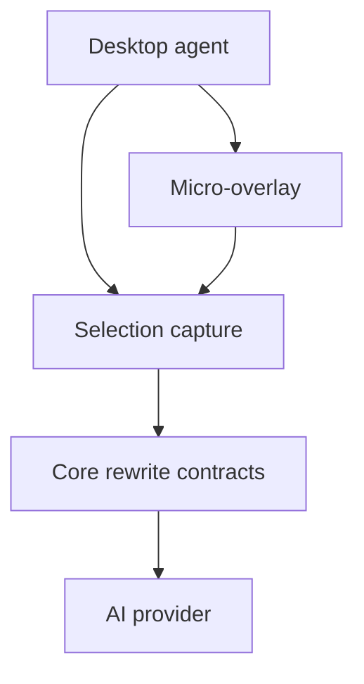

# ParaPhraser architecture

## Current vertical slice

1. `GlobalHotkeyService` registers system-wide shortcuts through `RegisterHotKey`.
2. `ClipboardSelectionService` waits for the shortcut modifiers to be released,
   preserves the clipboard, sends `Ctrl+C`, and reads the selected text.
3. `OverlayWindow` shows a one-off contextual instruction composer beside the cursor.
4. `RewriteCoordinator` sends the selection to the provider chosen in Settings.
5. The overlay shows the suggestion without saving conversation history.
6. When the user confirms, `ClipboardSelectionService` restores the original app,
   pastes the replacement, and restores the previous clipboard contents.

## Providers

`ChatTextTransformer` holds every prompt, so all modes behave the same on every
provider. It talks to an `IChatBackend`:

- `OllamaBackend` for offline mode.
- `AnthropicBackend` for Claude, using the official SDK. Its address is pinned so
  `ANTHROPIC_BASE_URL` cannot redirect a saved key.
- `OpenAiCompatibleBackend` for OpenAI, Gemini, and OpenRouter.

`OnlineProvider.All` lists the online providers. Add one that speaks the OpenAI
format by adding a line there. Model lists come live from each provider, so no
model names are built in apart from the Ollama default. If a provider's model
list is public, set `KeyCheckPath` to an address that needs a key, or any key
will pass the check on Save.

Every backend streams. `CompleteAsync` reports all the text so far through
`onText`, and `RewriteCoordinator` passes that to the overlay at most every 80 ms,
because rebuilding the document for each token stutters. Partial text goes through
`RichDocument.FromPartialModelOutput`, which hides half-written tags and code
fences. Format mode does not stream, because its reply is a list of phrases.
Stopping cancels the request, so an online provider stops generating and billing.

Temperature is sent only to Ollama, because current online models reject it. When
`IChatBackend.IsLocal` is false, application names and window titles are left out
of the prompt, and the overlay names the provider instead of saying processing is
private.

`AppSettings` encrypts keys with DPAPI for the current Windows user. A provider's
key error text is never shown, because some providers echo part of the key.

## Review and direct replace

`TextComparison` powers two things. `Compare` is the word-level diff behind
**Show changes**, and `FindMissingDetails` looks for numbers, dates, names, and
links the result dropped. It cannot see a lowercase name, so it supports reading
the changes rather than replacing that.

Direct replace (`RewriteCoordinator.HandleInstantAsync`) pastes with no review, so
it is deliberately cautious. Any missing detail, unsupported content, or failure
opens the normal overlay instead. It only runs the default instruction, which
keeps `ThrowIfNotAnEdit` fully active. `InstantToast` never takes focus, because
the paste must land in the user's app. Undo sends that app's own Ctrl+Z.

`ModelBusyException` marks failures another model could fix. The fallback comes
from `OnlineProvider.PickFallbackModel`, which stays in the same model family so
OpenRouter's long list cannot move someone to an unrelated paid model.

Global shortcuts are unregistered while a shortcut box has focus. Otherwise
pressing an existing shortcut would run it instead of reaching the box.

## Rich text

`RichDocument` is the only format the pipeline shares. Clipboard HTML and model
output both pass through its parser, which keeps an allowlist of formatting and
drops everything else, so model output never reaches the clipboard unfiltered.

- Capture reads the clipboard's HTML. A selection with no formatting stays plain
  text and takes the same path as before.
- `RichFlowDocument` converts to and from the overlay's editable `RichTextBox`.
- Formatted selections reach the model as a small HTML subset (`IsHtml`).
- Text color and highlight travel as CSS on `span`. Neutral colors are dropped
  because browsers stamp a default color on every run. After the model runs,
  `MatchColorsTo` removes colors the source never had and puts lost colors back
  on words that survived unchanged.
- Format is a separate mode. The model returns only a `FormattingPlan`, a list
  of phrases, and `RichDocument.ApplyFormatting` applies them by exact match, so
  the words cannot change. Do not move this into the rewrite prompt: when asked
  to emphasize while rewriting, the model invented sentences and deadlines to
  have something to bold.
- Paste puts both HTML and plain text on the clipboard. The rewrite is placed
  inside the source's own HTML document, because Word keeps fonts in its style
  sheet rather than on each paragraph.

## Boundaries

`ParaPhraser.Core` contains no WPF or Win32 dependencies. A cloud provider,
local model, or test transformer can therefore implement `ITextTransformer`
without changing selection capture or UI code.

## Planned next slices

- A setting for the context limit.
- Configurable shortcut settings stored per Windows user.
- UI Automation selection capture before the clipboard fallback.
- Direct replace mode with a visible undo notification.
- RTF capture for apps that do not copy HTML.
- Startup registration and installer/update integration.

## Security rules

- Never monitor or transmit keystrokes continuously.
- Capture text only after an explicit shortcut.
- Refuse password fields before sending Ctrl+C. `SensitiveFieldDetector` asks UI
  Automation, and fails open because not every app answers. Chromium browsers
  often report the page instead of the field, but they refuse to copy password
  fields, so nothing reaches the clipboard. Text an app marks with
  `ExcludeClipboardContentFromMonitorProcessing` is refused too.
- Treat selected text as untrusted, because it can be someone else's email.
  `ChatTextTransformer` fences it between markers that change per request, then
  `ThrowIfNotAnEdit` checks the result. The check matters more than the fence: on
  Gemma the fence alone stopped almost nothing, and rewording the prompt or moving
  the text did not help. It compares vocabulary, so an attack that reuses the
  source's words, such as answering in pirate speak, still gets through. The
  result is only ever shown as a suggestion, and the model has no tools.
- Never ship a shared AI provider key inside the desktop binary.
- `AppLog` must never receive selected text, model responses, instructions,
  window titles, or API keys. Log counts, names, and error codes. Do not log the
  error text from a rejected key, because some providers echo part of the key.
